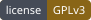
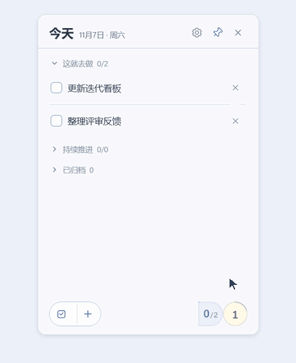
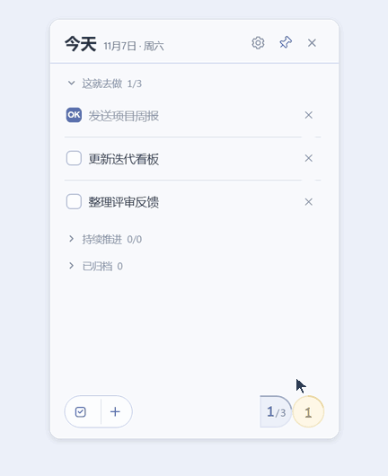
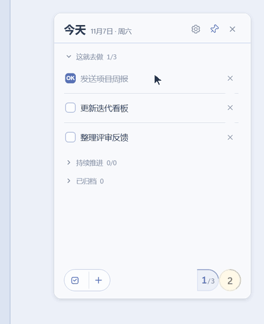

<p align="center">
  
</p>

# DOOK-From DO to OK.

[](#日常使用) [](#本地数据与mcp) [](LICENSE)

DOOK是一款面向日常工作的待办与小记应用。今天要做的事、需要持续推进的事、按周期重复的事，以及想先记下来的想法和备忘，都可以放在这里。

**[下载Windows x64版](https://github.com/SEVEN-TSY/dook/releases/latest)** · 提供安装包`.exe`和免安装包`.zip`。

## 设计理念

- **任务**｜今天要修登录页报错，我记一条，修完就勾掉。像重构鉴权这种要做几天的事，我放进「持续推进」，拆成迁移接口、补测试等子事项，分几天做完。
- **习惯**｜我每个工作日上午都要看CI有没有跑挂。设好周期和时间，「检查CI构建结果」就会自动出现在当天的任务清单里。
- **小记**｜排查接口超时时，我想到可以给重试加个退避策略。先记下一句，继续排查，回头再把想法和相关线索归到同一个主题。

## 日常使用

**桌面便签**可以置顶在手头的窗口旁边，也可以贴边自动收起。鼠标移到屏幕边缘就能看一眼完成进度，点一下即可展开。随手写下任务或小记，按Enter保存，做完一项就顺手勾掉。

便签里的任务和小记操作，在**主界面**也都能完成。主界面还可以把「持续推进」任务拆成子事项，逐项勾选，进度随完成情况更新。在这里也能设置习惯的生成周期和时间、暂停或重新启用习惯，以及整理小记主题、查看历史归档。两个窗口共用本地数据，修改即时同步。

启动后先显示桌面便签。单击系统托盘图标可唤出便签，右键可打开主界面或退出。关闭窗口会将它隐藏到托盘。

在主界面的设置中，可以切换浅色、深色或跟随系统外观，调整主题色、开机自启和便签行为。

**工作日报**可以从主界面任务筛选栏的日历图标打开，也可以从桌面便签直达。先在「设置 → AI服务」添加DeepSeek API Key并选好默认模型，就可以根据当天任务生成「今日工作内容」和「明日工作计划」。生成期间可以查看进度或取消，正文按日期保存在本机，可直接编辑和复制。日报的措辞和格式可以通过自定义提示词调整。

### 桌面便签操作演示

#### 添加任务并勾选完成

点击加号，输入「发送项目周报」并按Enter保存。发完周报后，勾选任务即可更新完成进度。



#### 切到小记记录评审备忘

点击底部的类别图标切到小记，记下「下次评审补充失败案例」，再切回任务列表。



#### 贴边收起，再快速展开

把便签拖到屏幕边缘，移开鼠标后它会自动收起。悬停边缘可查看任务进度，点击统计胶囊即可展开。



## 本地开发

项目使用Electron、React、TypeScript和SQLite。需要Node.js 24.15及以上的24.x版本。

```powershell
npm ci
npm run dev
```

也可以使用`pnpm install`和`pnpm dev`。首次启动需要下载Electron桌面运行时。

### 常用命令

| 命令                                    | 用途                                                      |
| --------------------------------------- | --------------------------------------------------------- |
| `npm run dev`                           | 启动开发版，修改主进程源码时自动重建并重启Electron        |
| `npm run typecheck`                     | 检查TypeScript类型                                        |
| `npm test`                              | 运行任务规则、数据库迁移和MCP等测试                       |
| `npm run smoke`                         | 运行真实Electron双窗口集成验证，结果保存在`.local/smoke/` |
| `npm run build`                         | 构建到`out/`                                              |
| `npm start`                             | 运行已有的生产构建                                        |
| `npm pkg get version`                   | 查看当前版本                                              |
| `npm version patch --no-git-tag-version` | 升补丁版本，例如从`0.2.0`升到`0.2.1`                    |
| `npm version minor --no-git-tag-version` | 升次版本，例如从`0.2.0`升到`0.3.0`                        |
| `npm version 0.3.0 --no-git-tag-version` | 直接指定版本为`0.3.0`                                    |
| `npm run pack`                          | 生成免安装目录到`release/`                                |
| `npm run dist:win`                      | 生成Windows x64 NSIS安装包到`release/`                    |
| `npm run format:check`                  | 检查代码和文档格式                                        |

升版命令会同步更新`package.json`和`package-lock.json`，Git提交和标签可单独处理。

只验证日报时，先执行`npm run build`，构建成功后执行`node scripts/run-smoke.mjs daily-report`。测试用模拟模型响应验证Electron界面和流式生成。

提交前用`git status --short`查看改动，用`git add -- "文件路径"`逐项暂存，再用`git diff --cached --stat`核对提交范围。确认后执行`git commit -m "提交说明"`。

在GitHub更新日报进展时，先将评论写入UTF-8文件`comment.md`。执行`gh issue comment 42 --repo SEVEN-TSY/dook --body-file comment.md`发表新评论。加上`--edit-last`可更新自己在该Issue的最后一条评论。其他Issue命令见[Issue操作指南](docs/agents/issue-tracker.md)。

## 本地数据与MCP

DOOK将任务、习惯和小记保存在本地SQLite数据库中，窗口位置和偏好也保存在本机。开发版和安装版使用独立的数据目录。

本地MCP端点默认为`http://127.0.0.1:32145/mcp`，当前提供`app_diagnostics`诊断工具。数据目录、端口设置和凭证用法见[MCP接入文档](doc/mcp.md)。

### MCP业务工具与AI能力（开发中）

- **对话管理任务**｜写代码时，可以在Codex等支持MCP的Agent里说「把补登录超时的回归测试加到今天」，也可以查询鉴权重构的进度，或让Agent把进度更新到DOOK。
- **生成周报和月报**｜按周或月汇总任务进展和完成情况，整理成可编辑的报工草稿。
- **从重复任务发现习惯**｜如果我经常手动添加「检查CI构建结果」，DOOK可以建议把它设为习惯，由我决定是否启用及何时生成。
- **从零散小记找出下一步**｜把几次排查接口超时留下的小记按主题归拢，从重复出现的线索里提炼改进建议，比如补一组重试边界测试。

## 项目文档

- [产品需求](doc/todo.md)
- [工程结构](doc/codebase.md)
- [界面框架与样式](docs/ui-framework-and-styles.md)
- [桌面便签验证](doc/desktop-validation.md)
- [工作日报](docs/specs/ai-daily-report.md)
- [MCP接入](doc/mcp.md)

## 开源许可

DOOK以[GNU通用公共许可证第3版](LICENSE)发布（`GPL-3.0-only`）。第三方组件遵循各自的许可证。

Copyright © 2026 SEVEN-TSY
