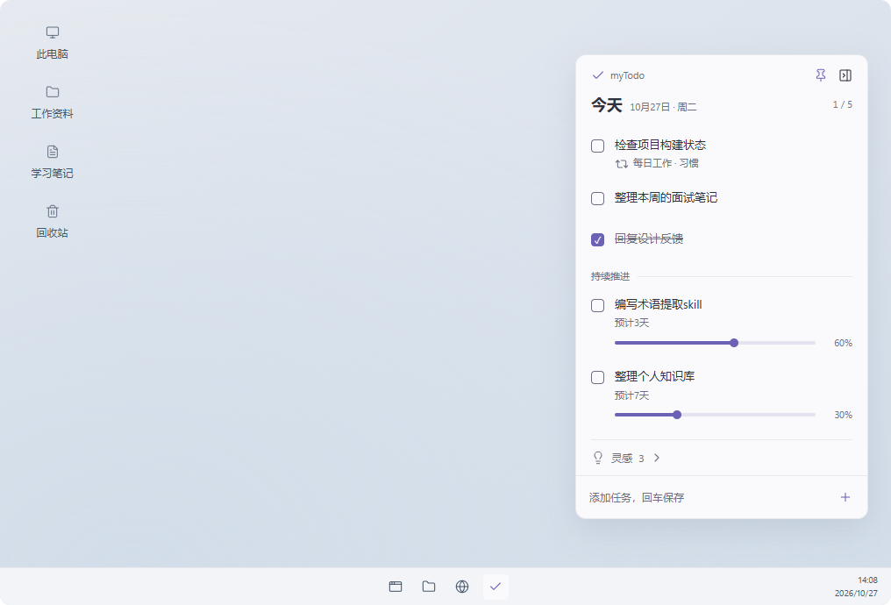

# myTodoUI风格规范

> 主界面已确定采用新的工作台设计语言，后续主界面设计与实现以[主界面设计语言](./design-language.md)为准。本文中与主界面布局和视觉方向有关的旧描述保留作历史参考；桌面便签暂沿用本文规范，待后续单独设计。

用户已确认整体方向为**蓝白简约、偏工作氛围的桌面便签**，以用户提供的[桌面参考图](./assets/ui/desktop-style-reference.png)为视觉基准。具体颜色与尺寸为实现起点，可在保持整体观感的前提下微调。

## 整体气质

清爽、克制、有秩序，适合持续工作时随手查看和操作。冷白内容表面搭配少量蓝色强调，以紧凑列表、轻圆角、柔和阴影建立桌面便签感。任务文字是主要视觉内容，边框、图标和辅助信息保持轻量。

桌面便签、完整管理页、设置页共用颜色角色、系统字体、图标与交互反馈，按各自功能组织布局。当前确认的是视觉方向与参考效果，产品界面的开发仍按功能需求推进。

## 颜色与材质

| 角色 | 浅色实现起点 | 用途 |
| --- | --- | --- |
| 内容表面 | `#FAFBFE` | 桌面便签、编辑浮层 |
| 正文 | `#303744` | 任务标题、主要内容 |
| 辅助文字 | `#6A7588` | 日期、习惯来源、子事项数量 |
| 强调色 | `#526FC4` | 勾选、进度、主要操作、聚焦提示 |
| 弱边界 | `#E5EAF1` | 便签边界、分隔线 |
| 悬停表面 | `#EEF2FB` | 当前可操作的任务行或控件 |
| 进度底轨 | `#E0E7F7` | 与蓝色已完成进度区分 |

使用纯色、清晰的内容表面，阴影轻且柔和。较大的背景区域保持中性；强调色集中在操作和状态。深色外观沿用相同结构与颜色职责，具体观感可随实现再微调。

## 桌面便签

- 贴边收起后保留6px可见入口和4×60px圆角细条，不显示文字。蓝色填充仅按已完成任务数／当前可见任务总数计算，不区分今天任务和多天任务，不计入未完成任务的部分进度；无任务时只显示底轨。左右边缘由下向上填充，上边缘由左向右填充。
- 悬停立即呼出椭圆胶囊，仅展示任务已完成数／任务总数，不显示灵感或图标。完成数使用16px字号，总数使用14px字号；左右竖向时完成数在左上、总数在右下，斜杠居中。胶囊长度与细条一致为60px，上边横向展示为60×28px，左右边竖向展示为28×60px；淡蓝色填充按对应方向表示完成比例；移出后恢复细条。点击胶囊展开便签，按住拖动沿当前屏幕边缘调整位置，松手保持收起并记住位置。悬停不抢焦点，任务数量沿用列表数据并同步刷新。

- 默认采用约334px宽的窄面板，放在桌面右侧；内容自然决定高度。
- 面板圆角约12px，内部左右留白约16px。顶部仅保留应用标识、位置固定与贴边收起操作。
- “今天”和日期构成页头，右侧显示完成数量。列表不设置侧栏和常驻详情。
- 今天任务在上，多天任务在下，使用一条轻分隔表达关系；已完成任务保留在原位。
- 习惯每天生成的今天任务进入同一任务列表，通过重复图标和“来自习惯”短说明标识其由习惯生成。
- 多天任务在描述下显示进度；有子事项时显示已完成数／总数，并按该比例计算进度，百分比右对齐。不显示或填写预计天数。
- 灵感默认折叠，仅显示标题和数量；底部固定提供新增输入位置。
- 展开灵感区后显示紧凑列表，点击单条灵感可展开补充内容，支持编辑原始想法和连续追加内容；主界面提供更宽的编辑空间。

## 分类呈现与主界面

桌面便签与主界面使用一致的分类规则，分别适配紧凑便签与完整管理布局。本轮调整以桌面便签为重点，同时调整主界面的分类呈现。

任务区包含今天任务和多天任务，今天任务在上、多天任务在下，以轻分隔线区分。习惯本身在主界面管理，习惯生成的任务进入任务区并标注“来自习惯”，表示这条任务由习惯创建。灵感区独立放在任务区下方，默认折叠并显示数量。

## 字体与密度

字体使用`"Segoe UI Variable Text", "Segoe UI", "Microsoft YaHei UI", "Microsoft YaHei", system-ui, sans-serif`。

| 元素 | 实现起点 |
| --- | --- |
| 桌面便签标题 | 18px，字重600 |
| 桌面任务正文 | 13–14px，常规字重 |
| 辅助文字 | 11–12px |
| 普通任务行 | 约47px起，附加信息时自然增高 |
| 多天任务行 | 为子事项数量和行内进度保留空间 |
| 图标 | 14–16px，统一线性风格 |
| 内部间距 | 4/8/12/16px为主 |

完整管理页可使用14px正文和更宽的编辑区域，保持相同字体层级与对齐规则。

## 操作与内容

勾选直接更新完成状态；底部输入任务描述并回车新增。首个业务版本的今天任务只包含一句简单描述，点击描述后直接行内编辑，回车保存、Esc取消，空白内容不能保存。主界面和桌面便签采用相同操作，不增加独立的标题、说明、备注字段或任务详情页。

底部新增输入框默认创建今天任务，旁边提供“任务／灵感”切换，切换为灵感后输入内容即新建灵感。习惯在主界面创建，也可从今天任务添加为习惯。

今天任务提供“转为多天任务”操作，多天任务由今天任务转换产生。添加子事项时也会自动转换为多天任务。有子事项时，进度按“已完成子事项数／总子事项数”计算，不要求填写预计天数。未完成的多天任务跨日持续显示，直到完成。

没有子事项的多天任务通过拖动进度条手动调整进度；有子事项时，进度条只展示结果，子事项支持展开、勾选和编辑。勾选整条任务将全部子事项设为完成，取消勾选将全部恢复未完成。多天任务完成当天保留原位，次日起从日常列表隐藏。

便签顶部的小图钉表达“窗口置顶”，默认开启；便签仍可拖动，不增加锁定位置功能，也不提供自动贴边按钮。贴边时沿用强制置顶及图钉亮起、禁用的行为，拖离后恢复自由置顶选择。主界面保持普通窗口行为。便签贴边后鼠标离开时沿当前边缘方向平滑收成细条，鼠标移入呼出统计胶囊，点击后从胶囊沿同一方向扩展为便签。鼠标移入时细条立即隐藏，胶囊准备及推出期间持续隐藏，避免原生窗口调整大小时细条重绘闪动；独立胶囊向屏幕内侧整体推出，数字随胶囊移动；胶囊离开时反向推回当前屏幕边缘并淡出，完成后细条从原位弹回。胶囊进入320毫秒、退出220毫秒，左侧向右、右侧向左、上侧向下。胶囊到便签使用独立共享表面做460毫秒弹簧投影，校正圆角，数字与列表独立交接；收起使用300毫秒，先完成视觉过渡再缩小原生窗口。文字始终保持原始比例，原生窗口不逐帧拉伸宽高。实现依据见[胶囊与便签过渡调研](./capsule-window-motion-research.md)。

该版本中主界面最小化或点击关闭按钮时隐藏到托盘，便签点击关闭按钮时隐藏自身，所有窗口隐藏后应用继续运行。单击托盘图标打开便签；右键菜单提供“打开主界面”和“退出”，支持后续扩充功能项。

习惯内容优先围绕固定、重复的工作事项，例如检查项目构建状态、更新工作进展、处理每日待办；生活习惯继续作为可自行添加的次要场景。主界面文案直接、简短，以工作行动为中心。

## 桌面便签紧凑交互

- 便签底行左侧为添加任务胶囊，右侧为36px圆环进度，与输入胶囊等高、同排对齐；环内仅居中显示任务已完成数／任务总数，不展示灵感；右上角按设置、置顶、关闭排列，设置直接打开主界面设置页。
- 每个任务项固定48px高，长描述单行省略，悬浮可查看完整描述；按“这就去做”和“持续推进”分组，这就去做默认展开，持续推进默认折叠，标题旁始终显示各组已完成数／任务数，例如4/4，点击标题独立展开或收起。总进度始终包含折叠的任务。
- 任务列表滚动条距离便签右边界约3px，宽4px，透明轨道搭配低对比度灰色圆角滑块，悬停滑块时略微加深；任务文字保留原有左右留白。
- 行尾默认只显示删除叉号，悬浮叉号区域或键盘聚焦后，向左展示转换操作；各操作提供title说明。
- 便签中的今天任务不提供添加子事项操作，多天任务暂不展示子事项；多天任务仍以描述为主，进度使用低对比度细轨道与百分比。
- 底部新增入口为左对齐胶囊，左侧以任务和灵感图标切换类别，图标提供悬浮说明，右侧为加号；点击加号后胶囊从左侧原位平滑变长，在胶囊内输入，展开期间输入占用圆环左侧剩余空间，右侧圆环保持可见；回车或失焦保存成功后缩回，失败保留草稿。

- 便签任务支持在各自分类内上下拖动排序，置顶任务始终排在该分类前方；置顶任务与普通任务分别排序。置顶／取消置顶按钮紧邻删除叉号左边，与转换操作一起在悬停叉号或键盘聚焦时显示。顺序和置顶状态保存到本地并同步主界面。

- 底部切换灵感时采用黄色胶囊背景和点亮灯泡；任务进度环右侧另设同尺寸的灵感数量圆环，沿用输入框暖黄色系，以5条为目标显示进度，达到或超过5条时满环，数字仍显示实际数量。环线保持原有粗细并采用浅黄色，数字居中，点击定位主界面灵感页。新增灵感及双窗口变更实时同步数量。

- 习惯任务以右侧时钟标识，悬停或键盘聚焦该按钮时切换为叉号，提示“暂停一次”，点击后只忽略今天这次习惯任务，不弹出删除确认，明天继续生成；不提供转为多天任务或直接编辑描述，点击描述打开主界面的习惯页。
